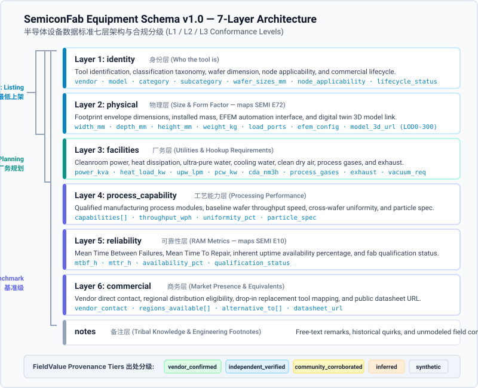

# SemiconFab Equipment Schema v1.0

## 1. Overview / 概述

The SemiconFab Equipment Schema v1.0 is an open, machine-readable data standard designed to describe semiconductor manufacturing tools across front-end wafer fabrication and back-end packaging. It establishes a structured specification format for equipment manufacturers, fab planners, industrial engineering teams, and academic researchers to catalog physical footprints, utility hookups, process capabilities, and reliability metrics without exposing proprietary process recipes or confidential pricing.

SemiconFab 设备数据标准 v1.0 是一个开放、机器可读的数据交换规范，旨在统一描述半导体前道晶圆制造与后道封装测试的各类制造设备。本标准为半导体设备制造商、晶圆厂规划工程师、工业工程团队以及学术研究人员建立了一套结构化的数据描述体系，用于收录设备物理占地、厂务二次配管配线需求、工艺能力及设备可靠性指标，同时严格避开厂商专有工艺配方与商业机密价格。

---

## 2. Why It Exists / 制定背景：芯片制造设备的数据困境

The semiconductor equipment industry currently relies on fragmented, unstructured documentation that hinders transparent technical evaluation:

半导体设备行业长期依赖离散、非结构化的技术文档，制约了客观、透明的技术评估与产线规划：

- **Inconsistent Vendor Datasheets (厂商规格书格式碎片化)**: Equipment manufacturers publish technical specifications across varied PDF layouts, non-standard unit systems, and marketing summaries. Critical engineering parameters—such as SEMI E72 equipment footprint dimensions, exhaust volumes, and apparent electrical power—are frequently omitted, inconsistently measured, or buried in non-indexable drawings.  
  设备厂商的技术规格分散在版式迥异的 PDF 手册、非标准化单位制及营销彩页中。外形几何尺寸（SEMI E72）、厂务排风量、视在功率等核心工程参数经常缺漏、口径不一，或深埋于无法被机器索引的图纸中。
- **Evaluation Barriers for Alternative Toolmakers (替代设备评估门槛高企)**: Emerging equipment vendors face substantial obstacles when competing with established incumbents. Fab procurement and industrial engineering teams lack a neutral, standardized framework to perform objective drop-in replacement evaluations, resulting in prolonged qualification timelines and entrenched vendor lock-in.  
  新兴设备厂商在与传统主导厂商竞争时面临极高的评估壁垒。晶圆厂采购与工业工程团队缺乏中立、标准化的横向评估框架，难以执行精准的同口径替换可行性分析，导致验证周期漫长且容易形成被动绑定。
- **Absence of Machine-Readable Industry Standards (缺乏机器可读的设备数据标准)**: While SEMI standards govern hardware safety (SEMI S2), physical footprints (SEMI E72), and reliability accounting (SEMI E10), no open JSON Schema standard exists to exchange structured tool parameters. Fab digital twin modeling and capacity scheduling tools are forced to re-enter data manually for every project.  
  尽管 SEMI 现行标准规范了设备安全（SEMI S2）、设备占地（SEMI E72）与可靠性统计（SEMI E10），但在设备级规格数据交换领域，行业内仍不存在开放的 JSON 模式标准。晶圆厂数字孪生建模与产能调度仿真被迫对每个工程项目进行重复的人工数据录入。

---

## 3. The 7 Data Layers / 七层数据架构

The schema organizes equipment attributes into seven modular, decoupled layers, ensuring that records can be populated progressively as data becomes available:

本规范将设备属性解耦划分为七个独立的模块化数据层，确保记录可随着工程数据的逐步完备而逐层递进补充：

| Layer Key (层标识)   | Layer Name (中文名称) | Layer Scope & Description (定义与范围)                                                                                                                                                                                                        | Example Fields (核心代表字段)                                                  |
| -------------------- | --------------------- | --------------------------------------------------------------------------------------------------------------------------------------------------------------------------------------------------------------------------------------------- | ------------------------------------------------------------------------------ |
| `identity`           | 身份层                | Canonical equipment identification, classification taxonomy, wafer size applicability, node target, and manufacturing status. 设备基础身份核验、大类归属、适用晶圆尺寸、适用制程节点及在产状态。                                              | `vendor`, `model`, `category`, `wafer_sizes_mm`, `node_applicability`          |
| `physical`           | 物理层                | Structural envelope dimensions, installed mass, automation interface configurations, and 3D digital twin geometry assets (aligned with SEMI E72). 设备外形几何包络尺寸、整机安装重量、晶圆搬送自动化端口及三维模型（对标 SEMI E72）。         | `width_mm`, `depth_mm`, `height_mm`, `weight_kg`, `load_ports`, `model_3d_url` |
| `facilities`         | 厂务层                | Utility consumptions and hookup requirements, including electrical power, cooling water, ultra-pure water, process gases, and cleanroom exhaust. 洁净室二次配管配线需求，包括动力供电、工艺冷却水、超纯水、干式压缩空气、特气消耗及酸碱排气。 | `power_kva`, `heat_load_kw`, `upw_lpm`, `cda_nm3h`, `process_gases`, `exhaust` |
| `process_capability` | 工艺能力层            | Qualified process modules, baseline wafer processing throughput, across-wafer thickness/etch uniformity, and defectivity limits. 设备支持的合格工艺模块清单、参考工艺条件下的晶圆产出速率、晶圆内均匀度指标及微粒缺陷控制标准。               | `capabilities`, `throughput_wph`, `uniformity_pct`, `particle_spec`            |
| `reliability`        | 可靠性层              | Standard equipment reliability, maintainability, and operational availability metrics, mapped directly to SEMI E10 definitions. 运行可靠性、可维修性及设备本征开机率指标，严格对标 SEMI E10 RAM 状态定义及量产验证状态。                      | `mtbf_h`, `mttr_h`, `availability_pct`, `qualification_status`                 |
| `commercial`         | 商务层                | Public vendor contact points, regional service eligibility, direct drop-in replacement tool references, and public datasheet links. 厂商公开联系渠道、销售与技术服务区域、同口径直接替代型号对照关系及公开数据手册来源链接。                  | `vendor_contact`, `regions_available`, `alternative_to`, `datasheet_url`       |
| `notes`              | 备注层                | Unstructured engineering remarks, equipment maintenance notes, and field operational observations excluded from automated comparisons. 自由文本工程备注、维护注意事项及现场运行经验总结（不参与自动化机器横向参数比对）。                     | Free-text string / 自由文本字符串                                              |

---

## 4. Conformance Levels / 合规等级 (L1 / L2 / L3)

To lower the barrier to entry while maintaining rigorous standards for advanced industrial engineering, records are certified across three conformance levels matching SPEC.md §7:

为降低数据提交门槛，同时保障工业工程严谨性，规范设立了三个向后兼容的合规分级（严格对标 SPEC.md §7）：

- **Level 1 — Minimum Listing (`L1` 最低上架级)**:
  - **Required Layers**: `meta` + `identity` + `physical`.
  - **Intent & Target Audience**: Verifies that the tool physically exists, has an established vendor model designation, and can fit into cleanroom floorplan envelopes. Intended for rapid tool indexing and equipment discovery.
  - **Real Catalog Benchmark**: In the SemiconFab equipment catalog, 7 equipment models (including the Canon FPA-5550iZ2 i-line stepper, Ebara F-REX300 CMP polisher, Besi Datacon 2200 evo, and ACM Research Ultra ECP 3D) satisfy full L1 criteria with verified footprint dimensions, while 109 challenger tools currently reside in the pre-L1 `needs_footprint` pipeline awaiting physical dimensions.
  - **适用场景与对象**: 验证设备真实存在、具备公开型号标识，且物理尺寸可放入洁净室机台间距中。主要用于设备目录快速收录与基础产品发现。在现有目录中，包括佳能 FPA-5550iZ2 光刻机、荏原 F-REX300 CMP 抛光机、Besi Datacon 2200 evo 固晶机及盛美半导体 Ultra ECP 3D 镀铜设备在内的 7 款机型已完整达成 L1 标准，其余 109 款设备暂存于待补全占地管线（`needs_footprint`）中等待尺寸补充。
- **Level 2 — Fab Planning (`L2` 厂务规划级)**:
  - **Required Layers**: `L1` requirements + `facilities`.
  - **Intent & Target Audience**: Provides complete cleanroom utility consumption data (electrical load, UPW, PCW, CDA, exhaust). Intended for fab layout planners and facility hookup engineers budgeting utility capacities.
  - **适用场景与对象**: 在 L1 基础上补全厂务二次配管配线负荷数据（电力视在功率、超纯水、冷却水、压缩空气、特气排气等）。服务于晶圆厂建厂规划与二次配厂务工程师。
- **Level 3 — Full Benchmark Grade (`L3` 完整基准级)**:
  - **Required Layers**: `L2` requirements + `process_capability` + `reliability` + `commercial`.
  - **Intent & Target Audience**: Provides end-to-end operational metrics, including SEMI E10 availability, wafer throughput rates, drop-in replacement references, and qualification history. Intended for discrete-event fab simulation, capacity planning, and technical replacement audits.
  - **适用场景与对象**: 在 L2 基础上补齐工艺性能、SEMI E10 可靠性指标与替代关系对照。服务于晶圆厂离散事件仿真（如 MIMAC 基准）、产能瓶颈分析及严肃的机台替换技术论证。

---

## 5. Provenance Tiers / 字段级出处分级

Trust in the SemiconFab catalog is established at the field level rather than the record level. Every quantitative and qualitative value is wrapped in a `FieldValue` object carrying an explicit provenance tier from SPEC.md §5:

SemiconFab 目录的信任建立在字段级而非整条记录级。每个数值或枚举值均被封装在 `FieldValue` 对象中，携带规范定义的五个出处等级之一（严格对标 SPEC.md §5）：

- **`vendor_confirmed` (厂商公开确认)**:
  - **Definition**: Data explicitly published in the equipment manufacturer's public datasheet, official technical manual, or attested by an authorized vendor representative.
  - **Example**: Equipment dimensions directly transcribed from an official brochure published on the vendor's primary domain (`width_mm = 3200`).
  - **定义与范例**: 由设备制造商在公开产品规格书、官方技术手册中明确公布，或经厂商认证代表正式提交。例如：设备宽度直接录自厂商官网公开 PDF（`width_mm = 3200`）。
- **`independent_verified` (独立验证)**:
  - **Definition**: Data verified through independent third-party testing, certified fab installation inspection, academic literature, or accredited laboratory test reports.
  - **Example**: Cleanroom acoustic noise verified by an ISO/IEC 17025 accredited metrology lab report (`noise_db = 68.5`).
  - **定义与范例**: 经过独立第三方机构测试、晶圆厂装机现场验收单、经同行评审学术论文或认证实验室检测报告验证。例如：设备运行噪声经检测机构实测标定（`noise_db = 68.5`）。
- **`community_corroborated` (社区交叉确认)**:
  - **Definition**: Data confirmed independently by two or more unrelated fab engineers, facility technicians, or research institutions without an official public datasheet.
  - **Example**: Ultra-pure water flow rate corroborated by facility logs from two independent semiconductor fabrication lines (`upw_lpm = 18.0`).
  - **定义与范例**: 缺乏原厂公开手册时，由至少两家无关联关系的晶圆厂运行团队、厂务技工或科研机构独立提供并相互交叉印证的数据。例如：超纯水流量经两座工厂运行记录印证（`upw_lpm = 18.0`）。
- **`inferred` (工程推断)**:
  - **Definition**: Engineering estimates calculated from scale references, related tool family architectures, physical scaling laws, or facility boundary equations.
  - **Example**: Machine depth estimated by pixel scale calibration against standard 300mm FOUP load port dimensions from cleanroom photographs (`depth_mm = 2450`).
  - **定义与范例**: 基于同系前代设备结构、标准物理放缩定律、现场照片比例尺标定或厂务外推模型估算的工程推断值。例如：通过晶圆装载端口（FOUP）标准物理尺寸在照片中的像素比例推算机身深度（`depth_mm = 2450`）。
- **`synthetic` (合成占位)**:
  - **Definition**: Numerically plausible placeholder values generated for digital twin simulation pipelines, stress testing, or mock demonstrators.
  - **Example**: Mean Time To Repair populated with a standard default value to enable discrete-event queuing simulation prior to production data collection (`mttr_h = 8.0`).
  - **定义与范例**: 为离散事件仿真运行、数据校验器压力测试或原型展示系统填充的数值合理占位符。例如：在真实量产统计收敛前，填入合理的行业均值以跑通排队仿真算法（`mttr_h = 8.0`）。

---

## 6. Architecture Diagram / 架构示意图

_Figure 1: The seven-layer modular stack of the SemiconFab Equipment Schema v1.0, showing conformance level boundaries (L1/L2/L3) and the underlying FieldValue provenance tiers._  
_图 1：SemiconFab 设备数据标准 v1.0 七层模块化架构堆栈、L1/L2/L3 合规等级边界及底层的 FieldValue 出处分级体系。_

---

## 7. Resources & Links / 相关资源与工具

Access the canonical specification documents, validation tools, and submission interfaces below:

您可以通过以下公开链接下载规范文档、调用校验工具或提交新设备规格：

- **JSON Schema Document (模式规范文件)**: Download the formal machine-readable schema definition: [`/schema.json`](/schema.json)
- **Technical Specification (完整技术规范文档)**: Read the normative SemiconFab Equipment Schema specification: [`/spec`](/spec)
- **Equipment Submission Form (在线设备规格提报表单)**: Submit equipment specifications via our schema-driven form: [`/add-equipment`](/add-equipment)
