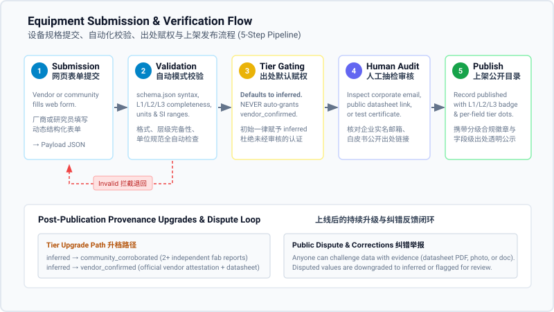

# Data Verification & Provenance

## 1. Overview / 信任基石：以透明替代权威

SemiconFab operates on a foundational philosophy: trust in industrial data is earned through complete methodology transparency rather than centralized claims of institutional authority. In semiconductor manufacturing, where access to definitive equipment datasheets is restricted by commercial practices and confidential agreements, asserting that an entire database is infallible is both unrealistic and counterproductive. Instead, SemiconFab isolates and tags every single specification parameter with its exact evidentiary origin, verification timestamp, and confidence tier. By openly distinguishing between vendor-published figures, engineering extrapolations, and simulation placeholders, we provide cleanroom planners and researchers with the unvarnished context required to make informed engineering judgments.

SemiconFab 坚守的核心理念是：工业数据的信任源自方法学的全面透明，而非中心化的机构权威背书。在半导体制造领域，由于商业保密协议与市场壁垒，获取完全权威的原厂设备技术白皮书极其困难，宣称某套数据库“100% 绝对权威”既不现实，也不负责。SemiconFab 的做法是：对每一项规格参数进行颗粒度解耦，为其标注独立且明确的数据来源出处、核验时间与置信等级。通过将原厂公开指标、工程推断值与模拟占位符公开区分，我们为晶圆厂规划工程师与科研人员提供真实无修饰的工程背景，支持其做出严谨的工程判断。

---

## 2. The 5 Provenance Tiers in Detail / 五级出处标准详析

Every quantitative and qualitative value in the catalog carries an immutable `provenance.tier` attribute. The table below details the evidentiary criteria, assignment authorities, and representative examples for each tier:

目录中的每一个具体参数数值均携带不可拆分的 `provenance.tier` 出处属性。下表详述各层级的判定证据标准、赋权责任主体与典型工程范例：

| Tier Key (出处层级)      | Evidentiary Meaning (定义与证据要求)                                                                                                                                                                                                                    | Assignment Authority (评定与赋值主体)                                                                                                        | Representative Example (典型应用范例)                                                                                                                                         |
| ------------------------ | ------------------------------------------------------------------------------------------------------------------------------------------------------------------------------------------------------------------------------------------------------- | -------------------------------------------------------------------------------------------------------------------------------------------- | ----------------------------------------------------------------------------------------------------------------------------------------------------------------------------- |
| `vendor_confirmed`       | Stated directly by the equipment manufacturer in a public datasheet, official technical bulletin, or submitted via an authorized corporate representative. 由设备制造商在公开发布的产品手册、官方技术白皮书中载明，或由认证的企业官方邮箱代表正式提交。 | Catalog Maintainer upon verifying corporate identity and source document. 平台审核员在核对企业法人身份及公开原始文件后手工赋予。             | A footprint width transcribed directly from an official product manual (`width_mm = 3200`). 机身宽度直接录自原厂官方 PDF（`width_mm = 3200`）。                               |
| `independent_verified`   | Evaluated against independent technical evidence, such as third-party lab inspection certificates, fab installation sign-off sheets, or peer-reviewed research papers. 经过独立第三方检测机构报告、晶圆厂装机现场验收交接单或同行评议学术论文严格核验。 | Catalog Maintainer upon auditing third-party reports or academic citations. 平台审核员在审阅第三方资质测试报告或学术引用后审核赋予。         | Cleanroom acoustic noise level verified by an accredited metrology report (`noise_db = 68.5`). 运行声噪经第三方权威实验室实测标定（`noise_db = 68.5`）。                      |
| `community_corroborated` | Confirmed independently by two or more unrelated fab engineers, facility operators, or research teams in the absence of a vendor datasheet. 缺乏原厂公开手册时，由至少两家无隶属关系的晶圆厂工程团队或科研机构独立提供并相互交叉印证。                  | Catalog Maintainer cross-checking 2+ independent, non-confidential submissions. 平台审核员在核对两份及以上无关联提交记录的数值一致性后赋予。 | Process cooling water load corroborated by facility logs from two logic fabs (`pcw_kw = 45.0`). 冷却水负荷经两座独立晶圆厂运行记录交叉印证（`pcw_kw = 45.0`）。               |
| `inferred`               | Derived from engineering calculations, related equipment family architectures, physical scaling laws, or cleanroom photo scale references. 基于工程经验估算、同系列前后代架构对比、物理缩放定律或洁净室现场实拍照片比例尺测算。                         | Assigned automatically by submission parser or submitter estimate. 数据提报表单提交时的系统默认初始等级，或提报人标明的工程推断。            | Machine depth estimated by pixel calibration against standard FOUP door height (`depth_mm = 2450`). 依据标准晶圆载具门高在照片中的像素比例推算机台深度（`depth_mm = 2450`）。 |
| `synthetic`              | Numerically plausible baseline values populated for digital twin initialization, simulation models, or test suite validation. 为离散事件排队仿真、数字孪生基准测试或数据校验工具初始化填充的数值合理占位符。                                            | Simulation engineers or benchmark dataset authors. 仿真建模研究员或基准套件维护团队生成，仅作模型跑通占位。                                  | Theoretical MTTR populated with typical industry average for queuing model testing (`mttr_h = 8.0`). 填入行业均值以支撑产能排队仿真运算跑通（`mttr_h = 8.0`）。               |

---

## 3. Submit-to-Publish Workflow / 从提交到发布的五步流水线

> [!WARNING]
> **Pipeline Honesty Notice / 流水线阶段实施诚信说明**:  
> While Stage 1 (web form entry) and Stage 2 (Schema v1.0 validation) are functional, **Stages 3–5 (tier gating, human review, and publication) are currently performed manually by the maintainer** following the runbook in `SUBMISSION.md`. End-to-end automated worker pipelines are planned for a subsequent release.  
> 目前阶段 1（网页表单填报）与阶段 2（Schema v1.0 规范校验）已完全可用；**阶段 3 至阶段 5（出处定级防刷、资质人工抽检、正式发布入库）当前由维护人员严格按照 `SUBMISSION.md` 运维手册手动执行**。全流程无人值守自动化 CI/CD 流水线已列入后续规划。

To prevent unvetted commercial claims from polluting the catalog while maintaining low submission barriers, records pass through a five-stage pipeline:

为杜绝未经证实的商业宣传污染公共数据库，同时保持开放的提报门槛，所有设备规格记录均须经过严格的五阶段流水线：

```
[1. Form Submission] ──> [2. Schema Validation] ──> [3. Tier Gating] ──> [4. Human Audit] ──> [5. Publication]
    网页表单提报              格式与范围自动化校验          默认赋予 inferred       原厂声明人工核验         带标公示发布
```

1. **Step 1: Submission via Web Form (网页表单提报)**:  
   Vendors, facility engineers, and researchers enter equipment specifications into the structured web submission form (`/add-equipment`). The form dynamically loads `schema.json` rules, ensuring data is captured in canonical SI units with mandatory field-level provenance metadata.  
   设备厂商、厂务工程师或研究人员在结构化网页表单（`/add-equipment`）中填写设备参数。表单动态加载 `schema.json` 规则，强制要求所有数值采用法定 SI 单位制并附带字段级出处元数据。
2. **Step 2: Automatic Schema Validation (自动化模式校验)**:  
   Upon submission, an automated validation worker parses the payload against `schema.json`. It verifies JSON syntax, validates regex patterns (e.g. UUID v4 identifiers), checks mandatory layer groupings for the declared conformance level (L1/L2/L3), and confirms SI unit keys. Malformed records are immediately rejected with descriptive field paths.  
   后端校验工作流使用 `schema.json` 对提交数据包进行语法解析。严格核验 JSON 格式、正则表达式（如 UUID v4 记录号）、所选合规分级（L1/L2/L3）对应的必填数据层完备性及单位合法性。不合规记录即刻拦截并返回精确定位到字段的报错信息。
3. **Step 3: Tier Assignment & Anti-Spam Gating (出处赋权与防刷关机制)**:  
   Every unverified field is automatically assigned the `inferred` tier by default. **The pipeline never automatically grants `vendor_confirmed` or `independent_verified` status.** Even if a submitter checks "Official Vendor", claims of primary authority cannot bypass human scrutiny.  
   所有未经核验的字段在入库时一律默认赋予 `inferred` 等级。**系统流水线绝不允许自动化授予 `vendor_confirmed` 或 `independent_verified` 标识。** 即使提交者自行勾选“厂商官方规格”，任何关于原厂官方背书的声明都绝不可能绕过人工审查自动生效。
4. **Step 4: Human Review of Official Claims (原厂资质人工抽检)**:  
   Records claiming `vendor_confirmed` status are placed in an audit queue. A catalog maintainer checks that the submission originates from an official corporate domain email, confirms that provided source URLs resolve to public technical manuals, and spot-checks key physical dimensions against public documentation. Submissions without verifiable corporate credentials remain published as `inferred`.  
   声明 `vendor_confirmed` 等级的记录进入待审队列。维护人员通过两项标准进行核查：提交人必须使用企业实名域名邮箱、提供的来源链接必须直达公开技术手册，并对机台外形几何尺寸进行抽检比对。无法出具企业原厂有效证明的提报将保持为 `inferred` 发布。
5. **Step 5: Catalog Publication with Tier Badges (带有出处徽章正式发布)**:  
   Approved records transition to `published` status and are merged into the public catalog. Every displayed field features an explicit provenance dot, allowing readers to instantly discern verified specifications from estimated values.  
   审核通过的记录状态变更为 `published`，正式并入公共目录库。网页前端展示的每个技术指标旁均附带高对比度的出处状态徽章，读者可瞬间识别各项指标是原厂确认还是工程估算。



_Figure 2: The end-to-end SemiconFab submission and verification pipeline, illustrating automated schema parsing, strict tier assignment gating, and the ongoing community correction loop._  
_图 2：SemiconFab 设备数据提交与核验完整流水线，展示自动化模式校验、严格出处赋权防刷关机制及上线后的社区纠错闭环。_

---

## 4. Tier Upgrade Path / 出处升级机制

A record in the catalog is not static; it improves over time as cleanroom operations generate additional empirical data. To ensure this process can be maintained by a solo maintainer without complex administrative overhead, upgrade criteria are designed to be concrete, deterministic, and lightweight:

目录中的设备记录并非静态快照，而是随着产线运行数据的积累持续演进。为确保单人维护者亦能高效运作该机制，升级规则设计得直观、确定且免除官僚冗余：

- **Upgrading from `inferred` to `community_corroborated` (升至社区交叉确认)**:
  - **Requirement**: Two independent engineering submissions from distinct organizations matching within a 5% measurement tolerance (for numerical values) or identical configurations (for categorical options).
  - **Procedure**: When a second independent engineer submits a matching value backed by operational experience, the maintainer links both anonymous records and advances the tier to `community_corroborated`.
  - **升档条件与流程**: 来自两个不同法人主体的工程师独立提报，数值偏差在 5% 以内或枚举配置完全一致。当第二位独立技术人员提供相互印证的工程数据时，维护人员确认无关联后即可升档为 `community_corroborated`。
- **Upgrading from `inferred` to `vendor_confirmed` (升至厂商公开确认)**:
  - **Requirement**: Official confirmation by the equipment manufacturer.
  - **Procedure**: A verified representative of the tool manufacturer submits an official datasheet link, product whitepaper, or attestation from an official corporate email domain. The maintainer archives the reference URL and promotes the values to `vendor_confirmed`.
  - **升档条件与流程**: 设备制造商官方正式背书。厂商认证代表提供官方产品白皮书公开链接或通过企业实名邮箱出具规格说明单，维护人员存档链接后一键将相关字段晋升为 `vendor_confirmed`。
- **Upgrading to `independent_verified` (升至独立第三方验证)**:
  - **Requirement**: A public, citable measurement report from an ISO-accredited testing body, cleanroom facility acceptance certificate, or published academic literature.
  - **Procedure**: The submitter supplies the report DOI, report serial number, or installation acceptance docket. Upon verification, the maintainer marks the parameter as `independent_verified`.
  - **升档条件与流程**: 提供具备国家或国际认证资质的检测机构检测单、晶圆厂装机验收签字文件或学术论文 DOI 编号。核查真实有效后赋予 `independent_verified`。

---

## 5. Catalog Badges & UI Indicators / 页面徽章与数据完整度标识

When browsing the equipment catalog, readers are presented with clear visual indicators reflecting record maturity and field accuracy:

用户在浏览设备详情页时，系统通过标准化的视觉徽章实时标识整机完备度与字段级可信度：

- **Record-Level Conformance Badges (整机合规分级徽章)**:
  - **`L1: Minimum Listing` (最低上架)**: Green outline pill indicating the tool exists, has verified identity, and physical footprint envelope is defined.
  - **`L2: Fab Planning` (厂务规划)**: Teal badge indicating utility hookups and cleanroom consumption data are complete for facility planning.
  - **`L3: Benchmark Grade` (完整基准)**: Indigo badge signifying comprehensive process capability, SEMI E10 reliability, and drop-in alternative mapping for simulation.
  - **`Draft` / `Under Review` (草稿与审核中)**: Neutral gray indicator denoting unverified or incomplete incoming submissions.
- **Field-Level Provenance Dots (字段级出处指示圆点)**:
  - Every specification field renders a color-coded indicator alongside the value:
    - 🟢 **Green Dot**: `vendor_confirmed` (Official manufacturer publication).
    - 🔵 **Blue Dot**: `independent_verified` (Third-party certified measurement).
    - 🟡 **Yellow Dot**: `community_corroborated` (Cross-confirmed by multiple fabs).
    - 🟠 **Orange Dot**: `inferred` (Derived calculation or scaling estimate).
    - ⚪ **Gray Dot**: `synthetic` (Simulation placeholder).
- **"Help Complete This Record" Call to Action (数据众包补全倡议)**:
  - On records with incomplete L1, L2, or L3 layers (such as the 114 imported tools currently filed under `needs_footprint`), an interactive banner highlights missing parameters (e.g. "Missing Layer 2: Physical Footprint Width, Depth, Height" or "Missing: Ultra-Pure Water Flow Rate and Process Exhaust"). Clicking the banner opens a pre-filled submission drawer, allowing cleanroom engineers with field knowledge to contribute specific missing values directly.  
    在未达到 L1、L2 或 L3 完整度的设备页面上（例如当前收录在 `needs_footprint` 目录下的 114 款待补占地机型），系统会醒目标注缺失的数据项（例如：“缺失物理层外形包络尺寸（长宽高）”或“缺失超纯水流量与排气参数”）。工程师点击即可拉起快速补全抽屉，针对单项参数定向补充出处与工程实测数值。

---

## 6. Public Corrections & Dispute Resolution / 公开纠错与争议处理

Transparency requires a rapid, accessible mechanism to dispute and correct erroneous data. Anyone—including competing vendors, fab operators, or researchers—can challenge an inaccurate value in the catalog:

真正的透明度必须包含便捷的公开纠错与争议复核机制。无论是设备厂商、晶圆厂运行一线工程师还是行业研究员，只要发现目录中的数据有误，均可随时提起纠错争议：

- **How to Submit a Correction (如何提交纠错)**:  
  Click the "Flag Error" button located beside any parameter on an equipment detail page, or email our maintainers at [`corrections@semiconfab.org`](mailto:corrections@semiconfab.org). Please include the `record_id`, the specific field key, your proposed correction, and supporting documentation (e.g., official datasheet PDF, field photograph, or measurement log).  
  点击设备详情页中任意字段旁边的“报错纠偏”按钮，或直接发信至平台维护邮箱 [`corrections@semiconfab.org`](mailto:corrections@semiconfab.org)。邮件请附上 `record_id`、争议字段名、建议更正值以及支撑证据材料（如公开手册 PDF、工程实拍图或测试记录）。
- **Dispute Gating Policy (争议处置原则)**:  
  Upon receipt of a substantiated correction claim, the disputed parameter is immediately downgraded to `inferred` with an annotation noting ongoing review. If the manufacturer or submitter fails to substantiate the original figure within 14 calendar days, the catalog adopts the corrected value backed by the new evidence. All revision histories are recorded immutably in the record changelog.  
  收到具备支撑证据的纠错请求后，争议数值将立即降级标记为 `inferred` 并标注复核中。若原数据提报方在 14 个自然日内无法提供更权威的反驳凭证，系统将依据新证据正式采纳更正数值。所有的更正历史均永久记录于该条记录的版本变更日志中。
